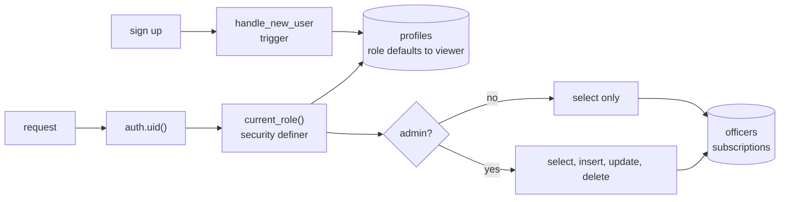

# 14th OTS Officers Database

CRUD web app for managing Pakistan Army 14th OTS officer records with role-based access, profile pictures, and subscription tracking.

## Stack

- React 19 + Vite + TypeScript
- Tailwind CSS v4 + shadcn/ui
- Supabase (PostgreSQL, Auth, Row-Level Security, Storage)
- TanStack Table
- React Router v7

## Roles

| Role | Permissions |
|------|-------------|
| `admin` | Full CRUD on officers, subscriptions, and profiles |
| `viewer` | Read-only access |

New users are automatically assigned the `viewer` role on sign-up.

## How access works



Eleven row-level policies, and every one of them asks the same function. The role is stored in
`profiles` rather than carried as a JWT claim, so promoting somebody takes effect on their next
query instead of their next login. `current_role()` is a security-definer function that reads the
caller's row and nothing else, which keeps the policy text to one comparison per table and gives
the whole authorisation model a single place to audit.

New accounts get `viewer` from the trigger, never from the client, so there is no request shape a
signed-up user can send to arrive as an admin.

Storage follows the same rule. The `profile-pics` bucket allows authenticated reads and admin-only
writes, so the bucket policy and the table policy cannot drift apart.

## Data

This repository ships the schema, the seed script and the interface. It contains no records.
`scripts/seed-from-excel.ts` reads a spreadsheet you supply yourself and needs the service-role
key, which is why that variable is documented as separate from the anon key.

## Local Setup

1. Install dependencies:

```bash
npm install
```

2. Create env file:

```bash
cp .env.example .env
```

3. Fill in Supabase credentials in `.env`:

```env
VITE_SUPABASE_URL=https://your-project-ref.supabase.co
VITE_SUPABASE_ANON_KEY=your-anon-key

# Only needed for the seed script
SUPABASE_URL=https://your-project-ref.supabase.co
SUPABASE_SERVICE_ROLE_KEY=your-service-role-key
```

4. Run locally:

```bash
npm run dev
```

## Supabase Setup

Run the single migration file in the Supabase SQL Editor:

```
supabase/migrations/001_schema.sql
```

This creates the `officers`, `subscriptions`, and `profiles` tables, RLS policies, the `handle_new_user` trigger, and the `profile-pics` storage bucket.

## User Management

### Add a new user

1. Supabase Dashboard → **Authentication** → **Users** → **Add User**
2. Enter email and password — the user is created with `viewer` role automatically.

### Promote to admin

Run in the Supabase SQL Editor:

```sql
UPDATE public.profiles
SET role = 'admin'
WHERE id = (
  SELECT id FROM auth.users WHERE email = 'user@example.com'
);
```

## CSV Import (one-time seed)

The seed script reads a multi-sheet CSV export of the officers Excel file.

```bash
npm run seed:excel -- /path/to/officers.csv
```

Expected sections in the CSV (each preceded by a `<Section Name>: Table N` header row):

- `Master Database`
- `Deceased`
- `15th OTS Passed Out`
- `Deceased 15 OTS`
- `Subscription` (optional)

The script upserts on `pa_no` so it is safe to run multiple times.

## Deployment (Vercel)

1. Push to GitHub.
2. Import the repo in the [Vercel dashboard](https://vercel.com).
3. Vercel auto-detects Vite — keep default settings:
   - **Build Command:** `npm run build`
   - **Output Directory:** `dist`
4. Add environment variables in Vercel:
   - `VITE_SUPABASE_URL`
   - `VITE_SUPABASE_ANON_KEY`
5. Deploy.

After deploying, add your Vercel URL to Supabase → **Authentication** → **URL Configuration** → **Site URL** and **Redirect URLs**.
